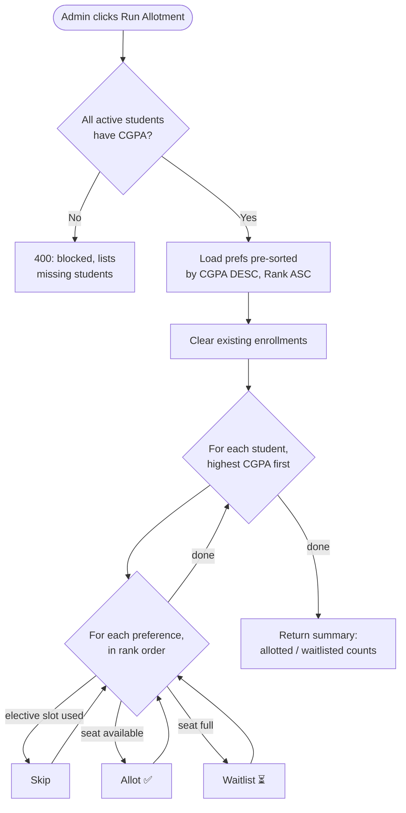
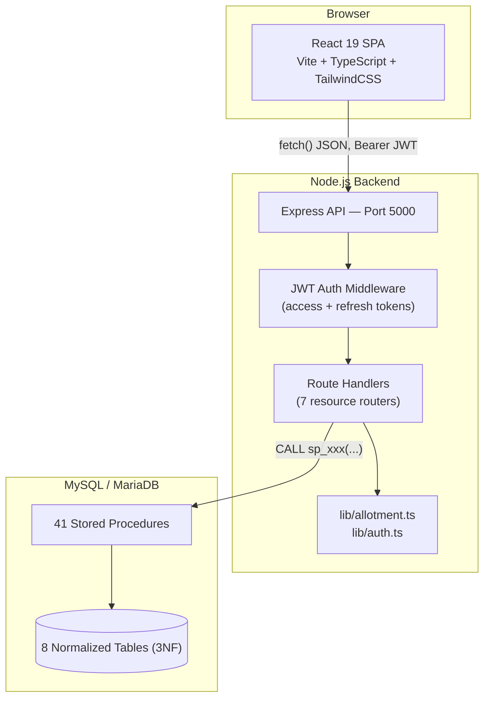
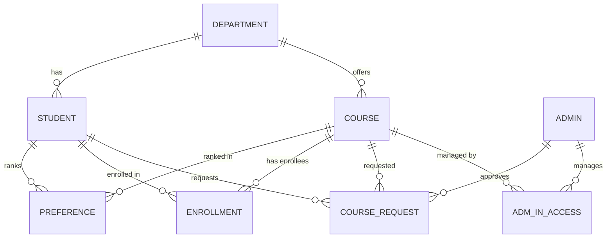

<div align="center">

# 🎓 Allocademy

**A full-stack, database-driven course registration system with a CGPA-priority seat-allocation engine.**

Built end-to-end — normalized MySQL schema, 41 stored procedures, JWT-secured REST API, and a React 19 SPA — to solve the real problem of fairly allocating limited course seats across a student body.

[](https://react.dev/)
[](https://www.typescriptlang.org/)
[](https://nodejs.org/)
[](https://www.mysql.com/)
[](https://vitejs.dev/)
[](https://vitest.dev/)
[](#-license)

[Live Demo](#) · [Documentation](#-full-technical-documentation) · [Report Bug](../../issues) · [Request Feature](../../issues)

</div>

---

## 📌 Why This Project

Most student CRUD projects stop at "students can log in and see a list of courses." This one goes further: it implements an **actual seat-allocation algorithm** — the same class of problem real universities, hospitals (residency matching), and lotteries solve — with deterministic, auditable, merit-based decision-making, backed by a properly normalized relational schema instead of a flat NoSQL blob.

If you're scanning this repo as a recruiter or hiring manager, here's what it demonstrates:

| Skill area | Where to see it |
|---|---|
| **Algorithm design & complexity analysis** | [`backend/src/lib/allotment.ts`](backend/src/lib/allotment.ts) — a greedy priority-fill allocation algorithm, O(P) core logic, unit-tested with Vitest |
| **Relational database design (3NF)** | [`backend/scripts/init-db.sql`](backend/scripts/init-db.sql) — 8 tables, composite keys, cascading FKs chosen deliberately per relationship |
| **SQL at scale** | [`backend/scripts/procedures.sql`](backend/scripts/procedures.sql) — 41 stored procedures, cursors, transactions-aware business rules via `SIGNAL SQLSTATE` |
| **Secure API design** | JWT access/refresh tokens with type-confusion protection, bcrypt hashing, RBAC middleware, parameterized queries everywhere |
| **Clean full-stack architecture** | Strict separation of concerns across a 3-tier system — React SPA → Express REST API → MySQL |
| **Production-mindedness** | I documented my own project's gaps (missing transactions, secret-fallback risk, N+1 queries) rather than hiding them — see [Known Trade-offs](#-known-trade-offs--roadmap) |

---

## 🧠 The Core Engineering Problem

> Given **N students** (each with a CGPA and a ranked list of course preferences) and **M courses** (each with fixed seat capacity), assign seats such that the result is **fair, deterministic, and explainable** — no manual spreadsheet wrangling, no black-box randomness.

This is a simplified, one-sided variant of the classic **college admissions / stable matching problem**. My solution:

1. Loads every preference row **pre-sorted by `CGPA DESC, Rank ASC`** directly from SQL — the entire fairness ordering falls out of one `ORDER BY` clause and JavaScript `Map` insertion-order, with **zero explicit sorting logic** in application code.
2. Walks students highest-CGPA-first; for each, walks their preferences in rank order, filling seats greedily while respecting live capacity and a **one-seat-per-elective-slot** constraint tracked with a per-student `Set`.
3. Runs in **O(P)** overall for P total preference rows (the nested loop's total iteration count sums to P, not S×P — see the write-up), with the real-world bottleneck being sequential DB writes, not the algorithm itself.
4. Is **fully deterministic and idempotent** — re-running against the same data always reproduces the same result, which matters when students ask "why didn't I get this seat?"



I unit-test this logic with **Vitest** against hand-built scenarios (capacity limits, tie-breaking, multi-preference students, elective-slot conflicts) — see [`allotment.test.ts`](backend/src/lib/allotment.test.ts).

---

## 🏗️ Architecture



**Design philosophy:** thin Express controllers validate input and delegate persistence entirely to named, parameterized **stored procedures** — no ORM, no hidden query generation, every database operation is traceable end-to-end from a React click to the exact SQL that ran.

---

## 🗄️ Database Design (3NF, 8 tables, 41 procedures)



Highlights I'd talk through in an interview:
- **Composite primary keys** on `PREFERENCE` and `ENROLLMENT` (`student, course`) — the natural key *is* the constraint, no surrogate ID needed.
- **Deliberately asymmetric cascade rules**: deleting a department `SET NULL`s a student's/course's department reference (they still exist independently), while deleting a course `CASCADE`s its preferences/enrollments (they have no meaning without it).
- **A conditional unique key** on `COURSE_REQUEST` — `(student, course, status)` — blocks duplicate *pending* requests while still allowing a fresh request after a prior rejection, without extra application logic.
- Business rules enforced **inside** stored procedures via `SIGNAL SQLSTATE '45000'` (e.g. "can't request a course you're already enrolled in"), not just in the API layer.

---

## ✨ Features

**Student**
- Signup gated to an institutional email domain + admin approval workflow
- Login via roll number *or* email
- Auto-personalized course browsing (own department/semester)
- Ranked preference submission with a configurable deadline
- View allotted / waitlisted results once admin-published
- Manual course-request channel for edge cases, independent of the bulk algorithm
- Drop enrolled courses

**Admin**
- Approve / reject / delete students, single & bulk CGPA updates
- Full course catalogue CRUD (core + elective course types, elective "slots")
- Per-course enrollment roster
- Pending course-request queue with approve/reject + reason
- One-click bulk allotment of a compulsory course to an entire department
- Run / clear / publish / unpublish controls over the allotment engine
- Live utilization dashboard

---

## 🛠️ Tech Stack

| Layer | Technology |
|---|---|
| Frontend | React 19, TypeScript, Vite 7, TailwindCSS 4, shadcn/ui (Radix primitives), react-router-dom 7 |
| Backend | Node.js, Express 4, TypeScript (native ESM) |
| Auth | JWT (access + refresh, type-confused-token-proof), bcrypt |
| Database | MySQL / MariaDB, `mysql2` (prepared statements + connection pooling), 41 stored procedures |
| Testing | Vitest |
| Tooling | ESLint, Prettier, `tsx` (zero-build-step dev), `concurrently` (monorepo dev orchestration) |

---

## 🚀 Getting Started

### Prerequisites
- Node.js ≥ 18
- MySQL or MariaDB running locally (or reachable)

### Setup

```bash
# 1. Clone
git clone https://github.com/<your-username>/online_course_portal.git
cd online_course_portal

# 2. Install everything (root + backend + frontend)
npm run install:all

# 3. Configure environment
cp backend/.env.example backend/.env
# edit backend/.env with your DB credentials + JWT secrets

# 4. Create the database, tables, procedures, and seed departments + one admin account
npm run setup

# (optional) seed sample courses for a quick demo
npm run seed

# 5. Run both frontend and backend together
npm run dev
```

The API runs at `http://localhost:5000`, the app at `http://localhost:5173`.

Default seeded admin (override via env vars before running setup): `admin@nith.ac.in` / `admin@123`

### Useful Scripts

| Command | What it does |
|---|---|
| `npm run dev` | Runs backend (`tsx watch`) + frontend (`vite`) concurrently |
| `npm run build` | Type-checks and builds both projects for production |
| `npm run setup` | Creates DB schema + procedures + seeds departments/admin |
| `cd backend && npm test` | Runs the Vitest suite for the allotment algorithm |
| `cd backend && npm run lint` | Lints the backend with ESLint |

---

## 📁 Project Structure

```
online_course_portal/
├── backend/
│   ├── scripts/         # DB setup, seeding, migration, and reset scripts
│   └── src/
│       ├── config/       # MySQL pool + app-wide constants
│       ├── lib/           # Auth helpers + the allotment algorithm (pure, unit-tested)
│       ├── middleware/    # JWT auth + role guards
│       ├── routes/        # One Express router per resource
│       └── index.ts        # App entry point
└── frontend/
    └── src/
        ├── components/     # Layouts, protected routes, shared widgets, shadcn/ui primitives
        ├── context/         # AuthContext (the app's single global state)
        ├── lib/              # fetch() wrapper + utilities
        └── pages/            # One component per screen (student + admin)
```

---

## 🔌 API Overview

RESTful JSON API, 7 resource groups, JWT Bearer auth on all protected routes:

| Resource | Base path | Examples |
|---|---|---|
| Auth | `/auth` | `POST /signup`, `POST /login`, `POST /refresh` |
| Courses | `/courses` | `GET /`, `POST /` (admin), `PATCH /:id` (admin) |
| Preferences | `/preferences` | `GET /`, `PUT /` (full replace) |
| Allotments | `/allotments` | `GET /me` |
| Enrollments | `/enrollments` | `GET /`, `POST /:courseId`, `DELETE /:courseId` |
| Requests | `/requests` | `POST /:courseId`, `POST /:id/approve` (admin) |
| Admin | `/admin` | `POST /allotment/run`, `/clear`, `/publish` |

Full endpoint-by-endpoint reference, request/response examples, and sequence diagrams are in the [technical documentation](#-full-technical-documentation).

---

## ⚖️ Known Trade-offs & Roadmap

I'd rather show I understand my own project's limitations than pretend it's flawless — this is what I'd fix next, in priority order:

- [ ] Wrap multi-step writes (allotment recompute, preference replace) in real DB transactions
- [ ] Remove the JWT-secret dev fallback; fail fast if unset in any real deployment
- [ ] Batch the allotment engine's per-row `INSERT`s into bulk writes for scale
- [ ] Add rate limiting on `/auth/login`
- [ ] Automatic waitlist promotion when a seat frees up, instead of requiring a full re-run
- [ ] CI pipeline (lint + typecheck + test on every PR)

---

## 📖 Full Technical Documentation

For a deep, chapter-by-chapter walkthrough of the entire codebase — every route, every stored procedure, the full algorithm complexity analysis, ER diagrams, sequence diagrams, and 200+ interview/viva-style Q&A — see [`docs/College_Course_Allotment_Portal_Documentation.pdf`](docs/College_Course_Allotment_Portal_Documentation.pdf).

---

## 🧪 Testing

```bash
cd backend
npm test
```

Vitest tests cover the allotment algorithm's core allocation logic: capacity-respecting fills, multi-preference students, full-course waitlisting, and in-rank-order allotment.

---

## 👤 Author

**Umashankar Kushwaha**
Computer Science, NIT Hamirpur
[LinkedIn](#) · [GitHub](#) · [Portfolio](#)

*Built as a DBMS lab project — designed and documented to the standard of a production system.*

## 📄 License

MIT — see [LICENSE](LICENSE) for details.

---

<div align="center">
<sub>⭐ If this project is useful or interesting, consider starring the repo.</sub>
</div>
